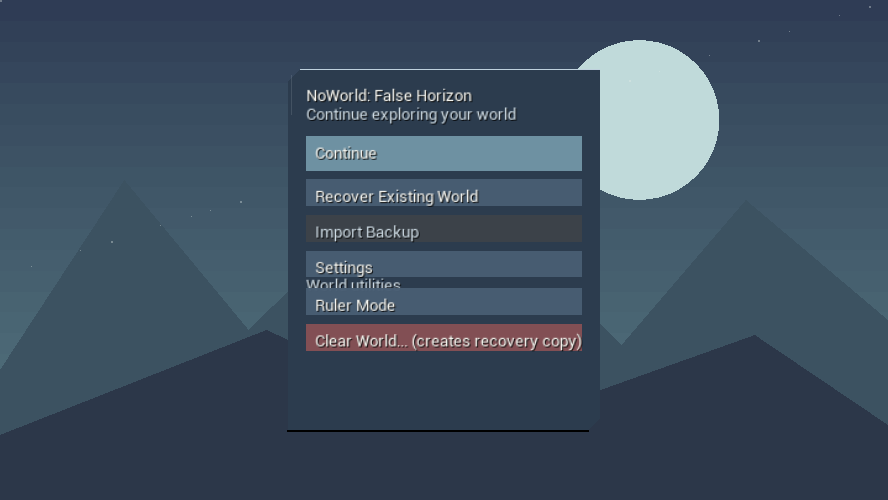

# Gate 12 Issue #25 — real Win64 startup integration evidence

Date: 2026-10-16. Engine: Unreal Engine 5.8.3. Branch: `production/gate12-koikatsu-ue583-fixture-20261010`.

## VERIFIED

1. **GameDefaultMap corrected** from the previous experimental Koikatsu test map to `/Game/Maps/StartingWorld`. This changes the game's startup route only; `EditorStartupMap` remains its QA test level and no character export, map asset, mesh, texture, Registry or visual design is modified.
2. `StartingWorld` is a real map with PlayerStart, lighting and native `/Script/OfflineGame.OGWorldPresentationGameMode` override. Read-only Unreal inspection `Saved/Gate12Readiness/starting_world_runtime_contract.json`: `READONLY_STARTUP_CONTRACT_PASS` with four startup contract checks true.
3. New no-cook Win64 game was launched using `Scripts/Gate12Koikatsu/run_isolated_nocook_desktop_smoke.ps1` and an isolated copied `.uproject` with its own `Saved` and SQLite world database. Original `Saved/OfflineGame/WorldState.db` timestamp/bytes stayed unchanged.
4. The second Win64 actual GAME launch logged `StartingWorld`, exited without fatal error, and captured a real `HighresScreenshot00000.png` of the opening UI, 56,526 bytes, SHA256 `B67EB0B019DD3C32786DD5122F02B81F39DF0FE05DDFFE47FC30A507C318AF06`.

The image is an actual Unreal Win64 GAME screenshot, not a UI mockup, theoretical capture or Android screenshot. It shows existing functionality and is **not** Gate10 visual-quality approval.

## Full source confidence preceding startup fix

- Win64 native C++ build: 7/7 PASS for passive Luminous viewer revision.
- Gate12 targeted suite: 10 clean + 1 warning + 0 fails (11/11), `Saved/Gate12Readiness/Native_Gate12_20261016_172323`.
- Complete native suite: 132 clean + 18 warnings + 0 fails (150/150), `Saved/Gate12Readiness/Native_Full_20261016_172503`.
- Editor-only asset preflight: `NATIVE_ASSET_PREFLIGHT_PASS_NO_COOK`, 45 authentic development QA CLOTHED parts available, no fabricated canonical ownership.

## NOT YET PROVEN

- Real local player **Ruler -> Characters -> World -> Ruler** control journey. Need actual live Ruler Widget visible screenshot, action log and persistence-reload comparison. Source tests or a screenshot of the opening menu do not prove this.
- Adult Mode actual visible gameplay and thirteen simultaneously rendered animated actors (thirteen persistent logical participants were previously source-tested only).
- Gate11 accepted production character binding (catalog remains empty), authored Gate09 animation, corrected material/morph/skeleton fidelity.
- Actual Samsung Galaxy S26 Ultra performance and Android cooking/install/device acceptance. **Explicitly prohibited** until separately authorized.
- Complete final Gate10 animated opening and all nine finished visual screens.

## Practical next action

Build a deterministic, opt-in no-cook game-runtime journey fixture inside **the isolated sandbox only**. It must invoke authentic Canvas/UMG handlers and create a real local Ruler using the canonical service in its isolated SQLite database, not mint a synthetic character/Manifestation. Collect actual HUD, Pawn, Ruler, World, return, screenshots and process outcome. Never use production saved data for this fixture.

No Android cooker, packager, APK installer, Registry mutation, asset-export pipeline change, Foundation mutation or PR #16 merge was performed.
