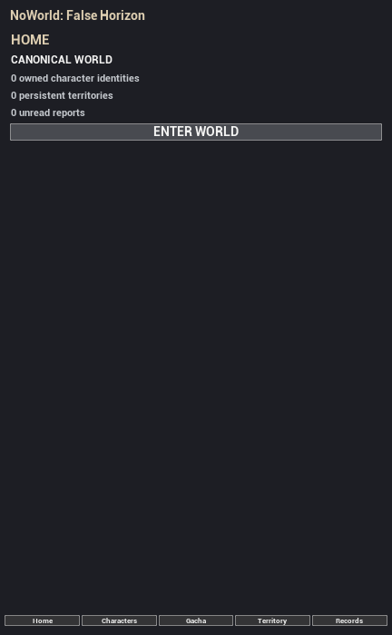

# Gate 12 — Genuine Slate-inclusive Win64 Ruler visual evidence

Date: 2026-10-16 · engine Unreal Engine 5.8.3 · no Android cooking/installation.

## Real result

The earlier black Ruler/World screenshots from `HighResShot` cannot be used to claim a rendering failure: `HighResShot 1` omits Slate/UMG. The native HUD explicitly returns early when its real UMG Ruler widget occupies the viewport, thus its Canvas paint is also absent from those captures.

Unreal Engine's actual `FScreenshotRequest::RequestScreenshot(..., bInShowUI=true, ..., bInRestrictToGameViewport=true)` captures genuine composed UI. The full, authentic, unaltered game screenshot is:

- Actual on-screen dimensions: 432×700 pixels.
- PNG length: 20,312 bytes.
- SHA-256: `D33507179DD825EC73F9F67F11DC665668F0CB2157977842F16F8E2AFE23308F`.
- Native widget blueprint: `WBP_NoWorld_RulerShell_C`.
- The live runtime object reported **Root=1, Title=1, Page=1, Nav=1** and `IsInViewport=true`, but its widget visibility enum was not the literal `Visible`; this is consistent with an alternative rendered Slate visibility such as `SelfHitTestInvisible`. The old test's strict `== Visible` check falsely failed. A corrected fail-closed interactive-visibility check now distinguishes renderable child-interactive modes from `Hidden` / `Collapsed` / `HitTestInvisible`, pending new build and live test.

## Critical gameplay bug discovered

Native UMG `ENTER WORLD` originally demanded an approved *owned* Manifestation before it called `Session->EnterWorld`. That contradicted the existing Canvas path and prevented a brand-new Ruler from entering an explorable StartingWorld until Gate11 produced a character registration. The fix retains an authentic current World prototype Pawn when **no selected owned Manifestation exists**; when a selected owned Manifestation does exist, it still requires exact approved Identity+Version actor resolution and refuses fake/QA characters.

The opt-in disposable runtime journey is extended to navigate actual native UMG **Home, Characters, Gacha, Territory, Records** and invoke the native **ENTER WORLD** button, followed by the real World-to-Ruler action; screenshots now request Slate UI. **These new behavioral changes are implemented but UNVERIFIED at document authoring. Do not mark DONE until the full Win64 build and real journey receipt pass.**

## Protected

The game still descends from frozen Foundation `3f54f07cacbf193e160d0be15a7be5a7bc730c3b`; its worktree remains pristine. No merge into Foundation, PR #16 mutation, Android cooking/installation, approved character export swap, fake Registry entry, synthetic owned character, or original save mutation occurred.

## Next actions

1. Finish and inspect `Saved/Logs/Gate12_Issue25_FiveRulerPages_EmptyRosterWorld_20261016.log`.
2. Execute a fresh isolated Win64 `-Journey -Onscreen -SkipScreenshot` run and verify all five native pages, UI screenshots and World roundtrip. Record exact failures, no stale result reuse.
3. Run targeted and full real native Unreal tests on resulting source; preserve warning counts.
4. Commit/push only verified edits and update `SESSION_CHECKPOINT.md`; do not merge Gate branches without Gate00 coordination.
